# 8. Manual de Usuario

**Proyecto:** Gestión de pedidos de una cafetería universitaria\
**Versión:** 1.0.0\
**Destinatarios:** clientes (estudiantes y docentes) y personal de la cafetería.

El sistema permite consultar el menú, hacer un pedido antes del receso y retirarlo en el mostrador mostrando un código, sin hacer fila. Este manual tiene una parte para **clientes** (sección 8.2) y otra para el **personal de cafetería** (sección 8.3), cada una en el orden en que se usa el sistema en el día a día. La instalación se explica en el *Manual de Instalación* (documento 7).

**Contenido**

- 8.1 Antes de empezar
- 8.2 Clientes: crear la cuenta, ingresar, pedir, confirmar, seguir el pedido y retirarlo
- 8.3 Personal: ingresar, atender pedidos, entregarlos y mantener el menú
- 8.4 Preguntas frecuentes

## 8.1 Antes de empezar

Abra en su navegador, en el celular o en un computador, la dirección que le indique la cafetería, por ejemplo `http://192.168.1.20:5000`. La página de inicio tiene dos accesos: uno para clientes y otro para el personal.

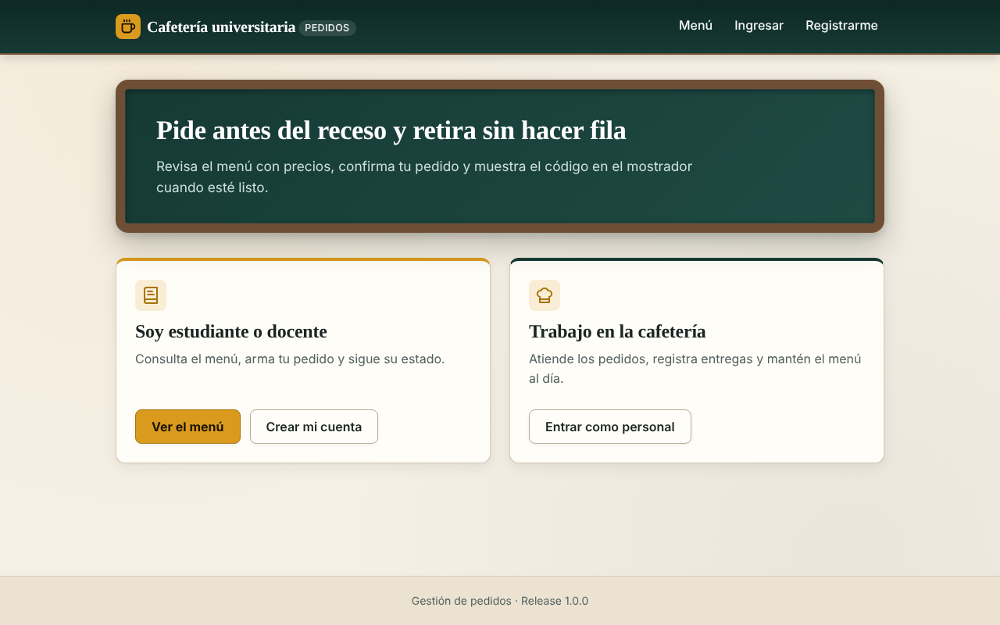
*Figura 8.1. Página de inicio.*

La barra superior siempre muestra las secciones disponibles y, después de ingresar, su nombre y el botón **Salir**. Las capturas de este manual están en modo claro; si su dispositivo usa el modo oscuro, el sistema cambia sus colores automáticamente.

En todas las pantallas, los avisos en **verde** confirman que una acción se realizó y los avisos en **rojo** indican un problema y qué corregir.

---

## 8.2 Clientes

### 8.2.1 Crear su cuenta (solo la primera vez)

1. Pulse **Registrarme** en la barra superior, o **Crear mi cuenta** en la página de inicio.
2. Complete el formulario:

   | Campo | Qué escribir |
   |---|---|
   | Nombre y Apellido | Entre 2 y 60 letras cada uno. |
   | Cédula | Su cédula ecuatoriana de 10 dígitos, sin guion. El sistema comprueba que sea válida. |
   | Celular | 10 dígitos que empiezan con 09, por ejemplo `0991234567`. |
   | Correo institucional | Su correo de la universidad, terminado en `@epn.edu.ec`. |

3. Pulse **Crear mi cuenta**.

El sistema le asigna un código de cliente (por ejemplo `CLI-00001`), que verá junto a su nombre en la barra superior, y lo lleva directamente al menú. Cada cédula y cada correo solo pueden registrarse una vez.

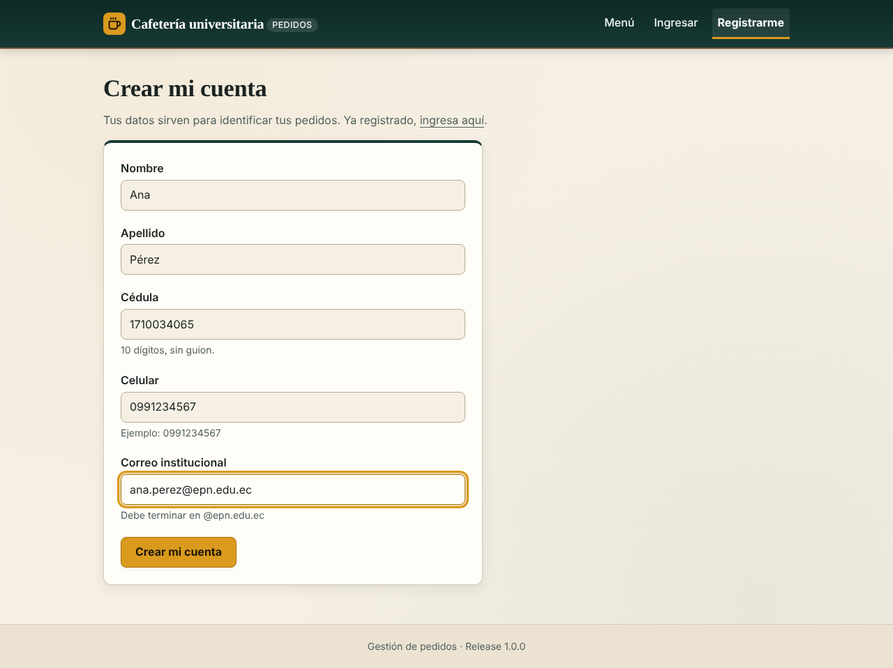
*Figura 8.2. Formulario de registro con datos de ejemplo.*

Si algún dato no es válido, aparece un aviso en rojo que indica qué corregir, y los datos ya escritos se conservan.

### 8.2.2 Ingresar en otra ocasión y salir

- Para ingresar, pulse **Ingresar** y escriba la cédula y el correo con los que se registró. No importa si escribe el correo en mayúsculas o minúsculas.
- Para salir, pulse **Salir** en la barra superior. Hágalo siempre en computadores compartidos.

### 8.2.3 Consultar el menú y elegir productos

1. Pulse **Menú**. Verá los productos disponibles, agrupados en «Para comer» y «Para tomar», con su código y su precio.
2. En la casilla a la derecha de cada producto escriba **cuántas unidades** quiere: un número entero entre 1 y 50. Deje vacíos los productos que no quiera.
3. Pulse **Revisar pedido**.

Puede consultar el menú sin ingresar, pero para pedir debe ingresar o registrarse; en ese caso, en lugar de las casillas aparece el aviso «Ingresa o regístrate para hacer un pedido».

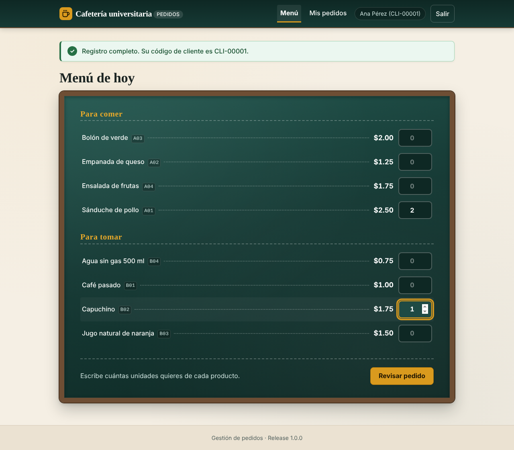
*Figura 8.3. Menú con dos productos seleccionados.*

### 8.2.4 Revisar el total y confirmar

La pantalla de revisión muestra cada producto con su cantidad, su precio, su subtotal y el **total a pagar**. El pago se hace en el mostrador al retirar.

- Para cambiar algo, pulse **Cambiar selección**: vuelve al menú con las cantidades que había escrito.
- Si todo está bien, pulse **Confirmar pedido**.

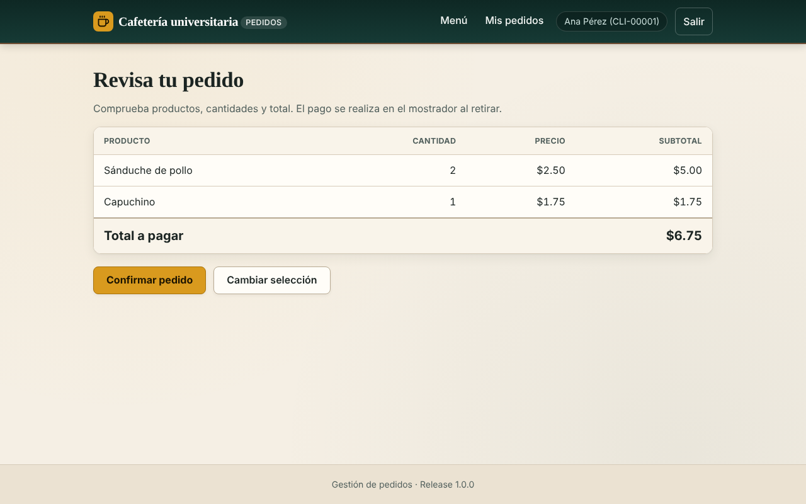
*Figura 8.4. Revisión del pedido antes de confirmarlo.*

Si la cafetería cambia un precio o se agota un producto mientras usted revisa su pedido, el sistema no lo confirma y le avisa. En el caso del precio, le muestra el nuevo total para que lo revise y confirme otra vez si está de acuerdo. Así usted siempre confirma el total que vio.

### 8.2.5 Su código de retiro

Al confirmar verá un ticket con el **código de retiro** de 6 caracteres. Es lo que mostrará en el mostrador. No necesita anotarlo: puede volver a verlo en cualquier momento en **Mis pedidos**.

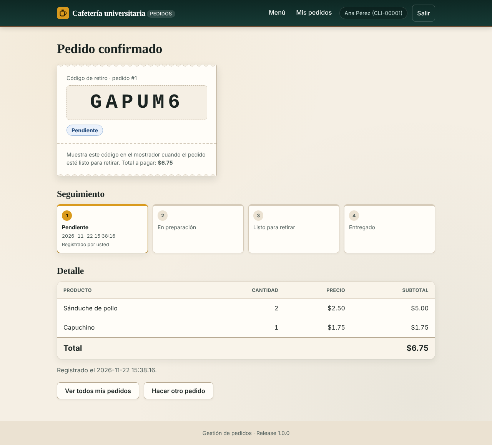
*Figura 8.5. Pedido confirmado con su código de retiro y su seguimiento.*

Debajo del ticket está el **seguimiento** del pedido, con la hora en que alcanzó cada estado:

| Estado | Qué significa para usted |
|---|---|
| **Pendiente** | La cafetería recibió su pedido y aún no empieza a prepararlo. |
| **En preparación** | Su pedido se está preparando. |
| **Listo para retirar** | Acérquese al mostrador con su código. |
| **Entregado** | Ya retiró su pedido. |

Desde esta pantalla puede pulsar **Ver todos mis pedidos** o **Hacer otro pedido**.

### 8.2.6 Consultar el estado de sus pedidos

Pulse **Mis pedidos** para ver todos sus pedidos, del más reciente al más antiguo, con su fecha, código, estado y total. Pulse el número de un pedido para ver su detalle y su seguimiento.

No hace falta recargar: la lista se actualiza sola cada 30 segundos, y el detalle de un pedido también, hasta que el pedido se entrega. Solo usted puede ver sus pedidos.

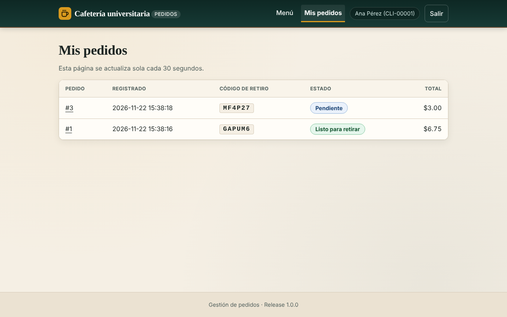
*Figura 8.6. Lista de pedidos del cliente.*

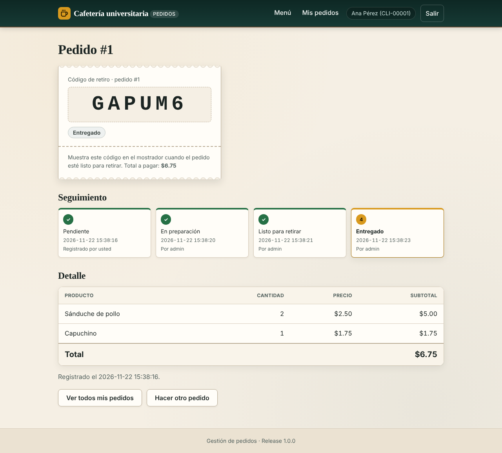
*Figura 8.7. Detalle de un pedido entregado, con la hora y el responsable de cada estado.*

### 8.2.7 Retirar el pedido

Cuando el estado sea **Listo para retirar**, vaya al mostrador, muestre o dicte su código y pague. El personal solo puede entregarle el pedido si el código coincide con el suyo.

### 8.2.8 Mensajes que puede ver

| Mensaje | Qué hacer |
|---|---|
| «La cédula ingresada no es válida (dígito verificador incorrecto).» | Revise que escribió bien su cédula. |
| «El celular debe tener 10 dígitos y empezar con 09.» | Escriba su celular completo, por ejemplo `0991234567`. |
| «Use su correo institucional (terminado en @epn.edu.ec).» | Regístrese con su correo de la universidad. |
| «Ya existe un cliente registrado con esa cédula.» o «…con ese correo.» | Usted ya tiene cuenta: use **Ingresar**. |
| «La cédula y el correo no corresponden a un cliente registrado.» | Revise los datos o regístrese. |
| «Seleccione al menos un producto para registrar el pedido.» | Escriba una cantidad en al menos un producto. |
| «La cantidad de … debe ser un número entero positivo.» | Use números enteros: 1, 2, 3… (no decimales ni negativos). |
| «La cantidad máxima por producto es 50.» | Reduzca la cantidad o consulte en el mostrador. |
| ««…» ya no está disponible.» | El producto se agotó: quítelo de su selección. |
| «Los precios cambiaron mientras revisaba su pedido…» | Revise el nuevo total y confirme otra vez si está de acuerdo. |
| «El formulario expiró…» | Recargue la página e inténtelo de nuevo. |

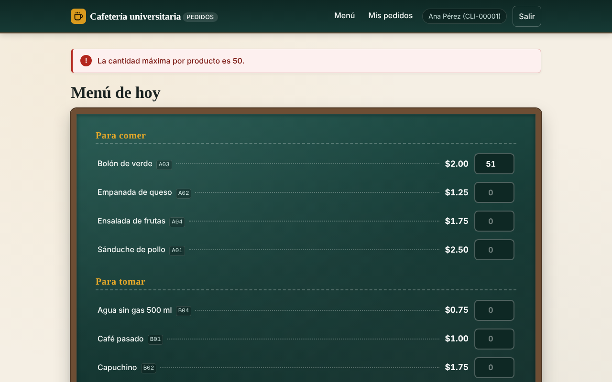
*Figura 8.8. Ejemplo de aviso cuando la cantidad supera el máximo.*

En el celular, el menú y las demás pantallas se adaptan al ancho de la pantalla:

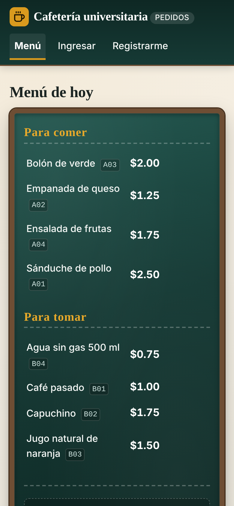

*Figura 8.9. Menú en la pantalla de un celular.*

---

## 8.3 Personal de cafetería

### 8.3.1 Ingresar y salir

En la página de inicio pulse **Entrar como personal**, escriba su usuario y su clave y pulse **Ingresar**. La barra superior muestra las secciones **Pedidos**, **Entregar** y **Menú**, y su nombre. Las páginas del personal no se pueden abrir sin ingresar.

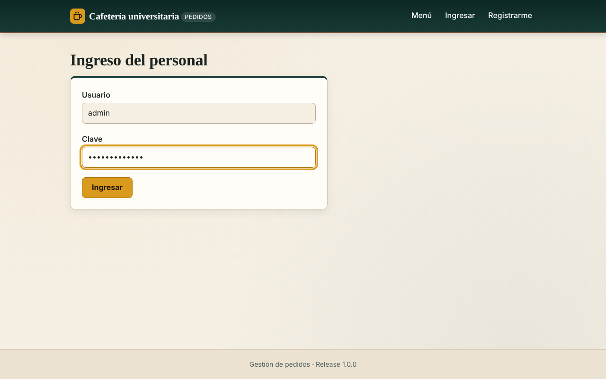
*Figura 8.10. Ingreso del personal.*

Pulse **Salir** en la barra superior al terminar el turno, sobre todo en equipos compartidos.

### 8.3.2 Atender los pedidos

La sección **Pedidos** tiene una pestaña por estado, con el número de pedidos de cada una. Los pedidos aparecen **en orden de llegada** (el primero de la lista es el más antiguo), con el nombre del cliente, la hora, los productos y el total. La página se actualiza sola cada 45 segundos, así que los pedidos nuevos aparecen sin recargar.

1. En **Pendiente**, pulse **Iniciar preparación** en el pedido que va a preparar.
2. En **En preparación**, cuando termine, pulse **Marcar listo para retirar**.
3. En **Listo para retirar**, el pedido espera al cliente; la entrega se registra en la sección **Entregar** (sección 8.3.3).

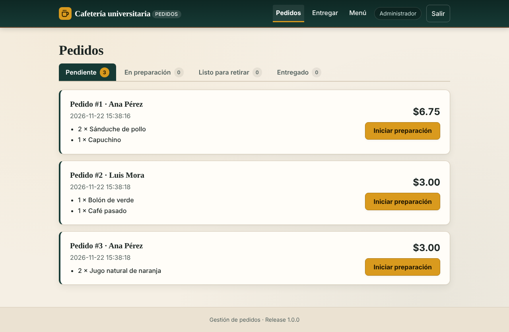
*Figura 8.11. Pedidos pendientes en orden de llegada.*

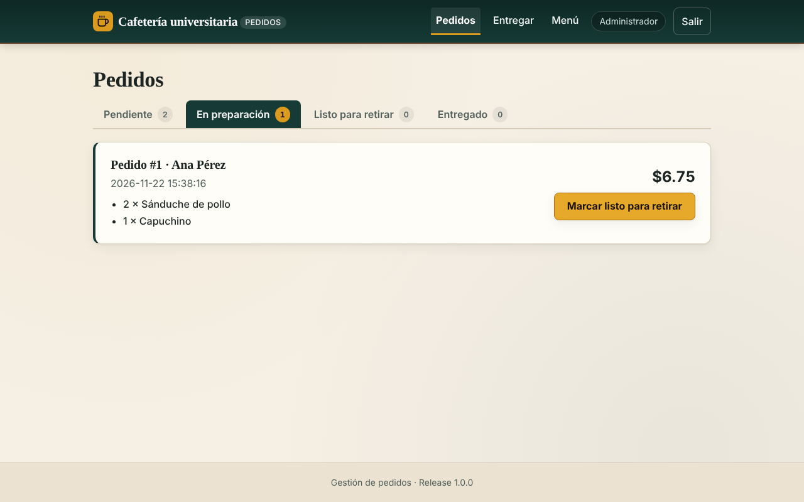
*Figura 8.12. Pedido en preparación, listo para marcarlo como listo para retirar.*

El sistema solo permite avanzar en ese orden y no deja saltar ni retroceder estados. Si otro compañero ya cambió el mismo pedido, aparece un aviso y el cambio no se repite; recargue la página para ver el estado actual.

### 8.3.3 Entregar un pedido

Por seguridad, la lista de pedidos **no muestra el código de retiro**: lo trae el cliente.

1. Abra **Entregar**.
2. Pida al cliente su código y escríbalo. No importa si usa mayúsculas o minúsculas, espacios o guiones. Pulse **Buscar pedido**.
3. Compruebe el nombre del cliente y los productos. Si el pedido está **Listo para retirar**, pulse **Registrar entrega**.

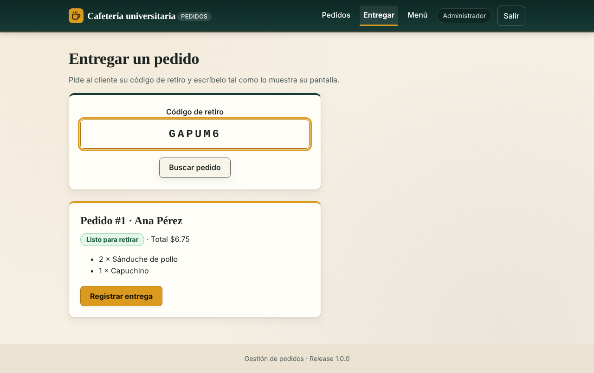
*Figura 8.13. Pedido encontrado con el código del cliente.*

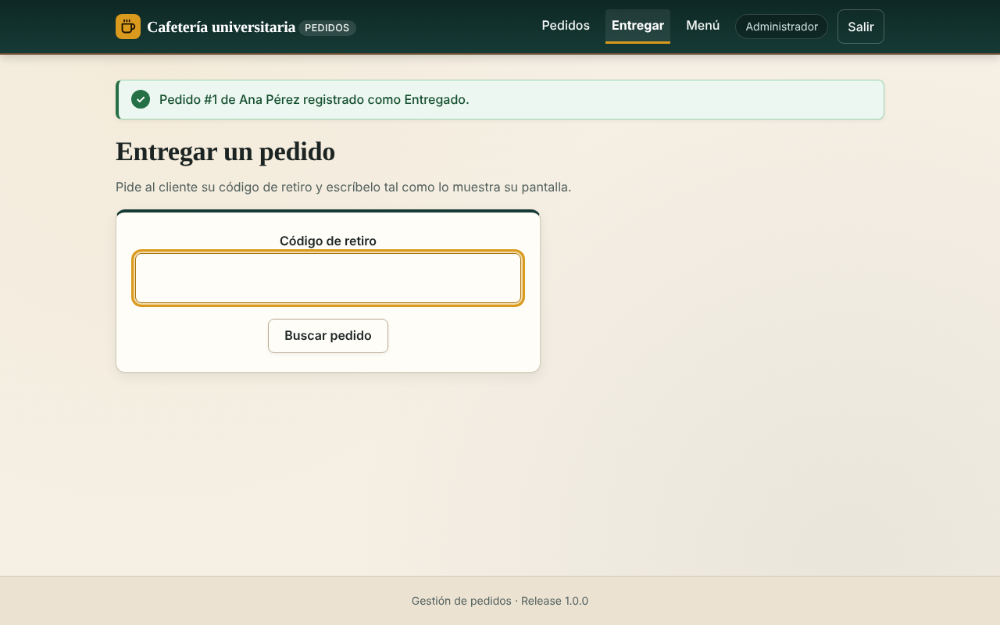
*Figura 8.14. Entrega registrada.*

El sistema no permite registrar la entrega en estos casos:

| Mensaje | Significado |
|---|---|
| «No existe ningún pedido con ese código de retiro.» | El código está mal escrito o no es de este sistema. |
| «Este pedido todavía no está listo para retirar.» | El pedido aún está Pendiente o En preparación. |
| «Este pedido ya fue entregado. No lo entregues otra vez.» | El pedido se entregó antes. |
| «El código presentado no corresponde a este pedido.» | El código no coincide con el pedido que se intenta entregar. |

### 8.3.4 Mantener el menú

En **Menú** verá todos los productos, incluidos los no disponibles, con su código, nombre, categoría, precio y disponibilidad.

- **Activar / Desactivar:** un clic cambia la disponibilidad. Un producto desactivado deja de aparecer en el menú de los clientes y no puede incluirse en pedidos nuevos. Los productos no se eliminan: se desactivan.
- **Editar:** cambia el nombre, la categoría, el precio o la disponibilidad. El código no se puede cambiar.
- **Agregar producto:** complete el formulario según estas reglas:

  | Campo | Regla |
  |---|---|
  | Código | De 2 a 10 letras, números o guiones, por ejemplo `B05`. Debe ser único y no se puede cambiar después. |
  | Nombre | Entre 2 y 80 caracteres. |
  | Categoría | Alimento o Bebida. |
  | Precio (USD) | Mayor que cero, hasta 1000.00 y con máximo dos decimales. Acepta punto o coma: `0.90` o `0,90`. |
  | Disponible para nuevos pedidos | Márquelo para que el producto aparezca en el menú de los clientes. |

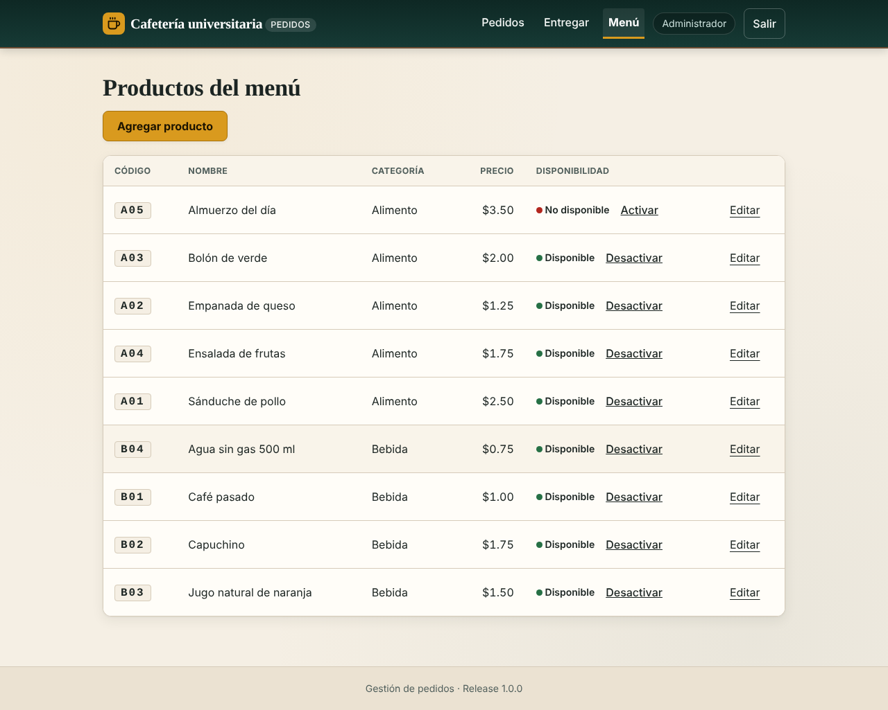
*Figura 8.15. Lista de productos del personal.*

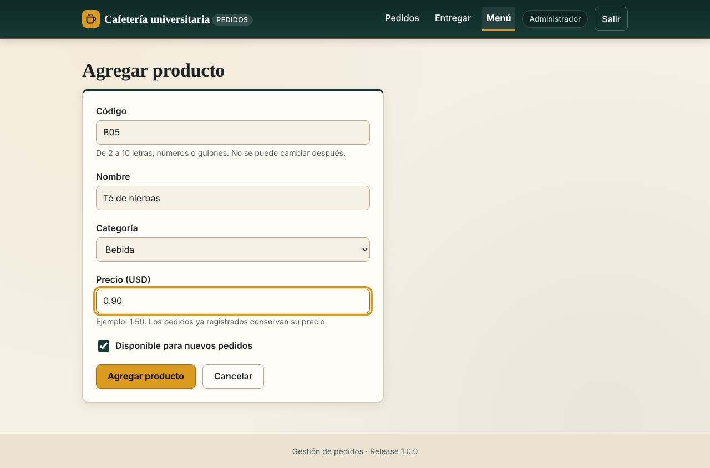
*Figura 8.16. Formulario para agregar un producto.*

**Cambios de precio:** los pedidos ya confirmados conservan el precio con el que se registraron; solo los pedidos nuevos usan el precio actualizado. Si un cliente estaba revisando su pedido cuando usted cambió un precio, el sistema le pide revisar el nuevo total antes de confirmar.

---

## 8.4 Preguntas frecuentes

**¿Se puede pagar en línea?** No. En esta versión el pago se realiza en el mostrador al retirar.

**¿Puedo cancelar o modificar un pedido ya confirmado?** No desde el sistema en esta versión. Comuníquelo en el mostrador.

**¿Recibiré una notificación cuando mi pedido esté listo?** No hay notificaciones por correo ni por mensajería. Consulte **Mis pedidos**, que se actualiza automáticamente.

**Perdí mi código de retiro.** Ingrese al sistema y ábralo en **Mis pedidos**.

**¿Puedo usar el sistema desde el celular?** Sí. Todas las pantallas se adaptan al celular; basta con abrir la dirección que indique la cafetería.

**¿Cómo se crea un nuevo usuario del personal?** Lo hace el responsable técnico con el comando descrito en el *Manual de Instalación*, sección 7.8.
